  

I'm a CS student at UCLA who builds ML systems **and** the infrastructure that runs them: data pipelines, model retraining, deploys, and the monitoring around them. I'm currently a tech lead shipping a production platform, and I'm heading toward MLOps on Google Cloud.

## 🔭 Featured

### 🏫 Practice Potential · Tech Lead
Production scheduling and identity platform for an education business. I lead the engineering end to end, from design through staged deploys to production.

`AWS` · `Lambda` · `Postgres` · `CI/CD` · `staging → prod`
 Private repo. Happy to walk through it.

### 🚌 [LaMetro](https://github.com/CadenMinami/LaMetro) · Real-time transit reliability + delay prediction
Ingests live LA Metro GTFS-Realtime feeds, scores every bus and train against its schedule, and **predicts next-window delays** with an XGBoost model that retrains nightly. Includes a live map and a neighborhood-level equity analysis of who gets the least reliable service.

`Kinesis` · `Lambda` · `DynamoDB` · `SageMaker` · `Step Functions` · `CDK` · `Next.js` · `ArcGIS`
 [Live demo](https://d1trwh3zs290xm.cloudfront.net) · [Equity map](https://d1trwh3zs290xm.cloudfront.net/equity/)

### ⚔️ [AI Battle Simulator](https://github.com/CadenMinami/acm_ai_battle_hackathon) · Bot-vs-bot arena for my ACM club
Write a bot in any language, drop it into a Clash-style arena, and watch it fight another bot. A tick-by-tick Python battle engine, an orchestrator that runs each agent as a separate process talking JSON over stdin/stdout, and a web viewer for replays, live matches, and single-elimination tournaments.

`Python` · `Docker` · `JavaScript` · `game simulation` · `process orchestration`

### 🎨 [ARIA](https://github.com/CadenMinami/aria-design) · Voice AI design collaborator · Google DeepMind Hackathon
Interviews you about your product in a real-time voice conversation, pushes back on vague answers like "clean and modern", and watches which reference sites hold your attention. Then it turns what you *say* and what you *linger on* into a design.

`Gemini Live API` · `TypeScript` · `Vercel`
 [Live demo](https://vibe-check-drab-one.vercel.app/)

## 🧰 Stack

## ⚡ Recent activity

<!-- ACTIVITY:START -->
- ⬆️ Pushed to [BruinBet](https://github.com/CadenMinami/BruinBet) · Nov 17
- 🔃 Opened 3 PRs in [BruinBet](https://github.com/CadenMinami/BruinBet) · Nov 17
- ⬆️ Pushed to [BruinBet](https://github.com/CadenMinami/BruinBet) · Nov 13
- ⬆️ Pushed to [youseeLA](https://github.com/troy-h-tian/youseeLA) · Oct 17
<!-- ACTIVITY:END -->

Updated daily by a [GitHub Action](.github/workflows/activity.yml). The header above is generated by [a small Python tool](tools/ascii_header) in this repo.

<picture>
  <source media="(prefers-color-scheme: dark)" srcset="https://raw.githubusercontent.com/CadenMinami/CadenMinami/output/github-snake-dark.svg">
  <source media="(prefers-color-scheme: light)" srcset="https://raw.githubusercontent.com/CadenMinami/CadenMinami/output/github-snake.svg">
  
</picture>

## 📫 Reach me

